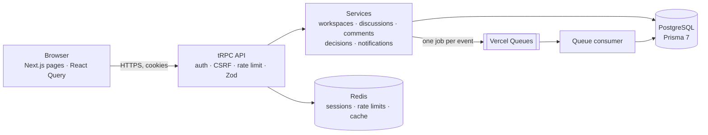

# Commons

> Conversations worth keeping. A workspace where small teams discuss, decide, and can still find out *why* months later.

**Live:** [collab-platform-web.vercel.app](https://collab-platform-web.vercel.app) · **Built in public** on [LinkedIn](https://www.linkedin.com/in/jinadu-olamilekan-5b8a15285/)

Chat moves fast and forgets. Documents get written once and go stale. Commons sits between them: discussions happen in a workspace, and when a discussion reaches a conclusion it becomes a **decision record** with its outcome, rationale, alternatives and full revision history. When a decision is later replaced, the old one stays readable and links to what replaced it and why.

---

## What works today

| Area | What it does |
| --- | --- |
| **Workspaces and roles** | Multi-tenant workspaces with OWNER, ADMIN and MEMBER roles, member onboarding by username, ownership transfer. One permission matrix decides who can do what. |
| **Discussions and comments** | Workspace discussions with threaded replies (up to 8 levels, loaded per parent) and `@mentions` limited to workspace members. |
| **Decision records** | Turn a discussion into a proposal, edit it, finalize it (owners and admins), supersede it with a linear replacement history, or delete it (authors while it is a proposal, managers otherwise). Every change is an immutable revision. |
| **Notifications** | One queue message per event; the consumer works out recipients and writes notifications idempotently. Production uses Vercel Queues; local development uses BullMQ. |
| **Sessions** | 15-minute access tokens tied to a live server-side session, silent refresh from a 7-day session, real revocation on logout and password change, CSRF protection. |

What is **not** built yet is on the [roadmap](apps/web/documentation/ROADMAP-commons.md): search, real-time updates, email digests, the document layer and more.

---

## Architecture

A modular monolith: one Next.js 16 App Router app serving the pages and a single tRPC API, backed by PostgreSQL and Redis.



The full picture, with subdomains and request flow, is in [ARCHITECTURE-commons.md](apps/web/documentation/ARCHITECTURE-commons.md).

Principles the code follows:

- **Thin routers, services own the rules.** Routers validate and delegate; services check membership and role, then touch the database.
- **One permission matrix.** `server/services/workspace.permissions.ts` is the single answer to "can this role do this?".
- **Safe by default.** Cross-workspace IDs return NOT_FOUND rather than revealing that something exists; creates are idempotent; concurrent edits are rejected with version checks instead of overwriting each other.
- **History is kept, not rewritten.** Decisions are versioned, deletions are soft, and deleting a user cannot take a workspace with it.

---

## Tech stack

| Layer | Technology |
| --- | --- |
| App | Next.js 16 (App Router), React 19, TypeScript |
| API | tRPC 11, Zod 4 (schemas shared in `packages/validators`) |
| Data | PostgreSQL (Neon in production) with Prisma 7, Redis (Upstash in production) |
| Jobs | Vercel Queues in production, BullMQ locally |
| UI | Tailwind CSS 4, Chakra UI 3, React Hook Form, Zustand |
| Tooling | pnpm workspaces, Turborepo, Vitest, `node:test`, GitHub Actions, Dependabot |

---

## Testing and CI

Around 270 automated tests, all run on every pull request:

| Suite | Covers |
| --- | --- |
| `test:auth` | Session refresh, revocation, spoofed headers, CSRF |
| `test:workspace-security` | The permission matrix and rate limiting |
| `test:discussion-security`, `test:comment-security`, `test:notification-security` | Tenant isolation, thread limits, notification delivery |
| `test:integration` | End-to-end API flows |
| `test:decision-db`, `test:decision-api` | Decision records against a real PostgreSQL database, including multi-process races |
| `test:frontend` | Around 185 component tests (Vitest) |
| `test:e2e` | Playwright smoke tests in Chromium against a production build: registration through a decision proposal to sign-out |

CI also checks lint and types, verifies that migrations match the Prisma schema exactly, builds the production app, audits dependencies and scans for committed secrets. Production database migrations run from GitHub Actions behind a manual approval.

---

## Running it locally

Prerequisites: Node.js 20.9+ (CI uses 24), pnpm 9, PostgreSQL and Redis.

```bash
git clone https://github.com/Layconnn/collab-platform.git
cd collab-platform
pnpm install
cp .env.example apps/web/.env   # then fill in DATABASE_URL, REDIS_URL and JWT_SECRET
pnpm -C apps/web exec prisma migrate dev
pnpm -C apps/web dev
```

Then open `http://localhost:3000`. [docs/DEVELOPMENT.md](docs/DEVELOPMENT.md) covers the details, including notification delivery and running the decision suites.

---

## How the work is done

- Every change is its own branch and pull request into `dev`, merged after CI passes; `dev` is released to `main`. See [docs/how-to-work-with-git-github.md](docs/how-to-work-with-git-github.md).
- Product and engineering documents live in [`apps/web/documentation`](apps/web/documentation): product, architecture, roadmap and investigations.
- AI agents (Claude Code) work from shared skills and commands in [`.claude/`](.claude), with hooks that block unsafe git operations.

---

## About

I'm Jinadu Olamilekan, building Commons in public to learn what it takes to make software that lasts: security first, tests as architecture, and honest notes about what broke.

I'm open to engineering roles on small European teams. [Let's talk on LinkedIn](https://www.linkedin.com/in/jinadu-olamilekan-5b8a15285/).
