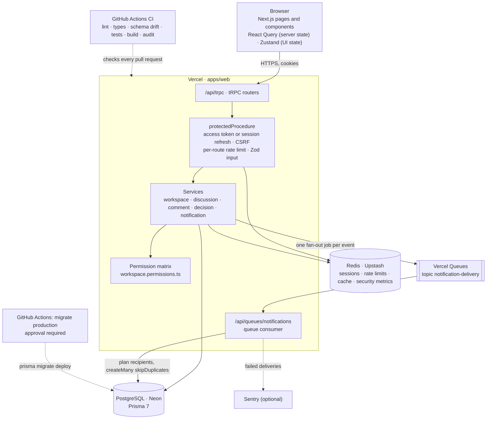

# Commons Architecture

Commons is a modular monolith: one Next.js 16 App Router application (`apps/web`) that serves the pages and a single tRPC API, backed by PostgreSQL (Prisma 7), Redis and a notification queue. Shared Zod schemas live in `packages/validators`.

## System Boundary

| Inside Commons | Outside Commons |
| --- | --- |
| Pages and client components under `apps/web/app` and `apps/web/components` | Vercel hosting, its Functions runtime and Vercel Queues |
| The tRPC API at `/api/trpc` and its routers, services and middleware under `apps/web/server` | Managed PostgreSQL and Redis providers |
| The notification consumer at `/api/queues/notifications` and the BullMQ worker | Sentry (optional, when `SENTRY_DSN` is set) |
| The Prisma schema and migrations under `apps/web/prisma` | GitHub Actions CI |

Every request follows the same path: client hook → tRPC route → `protectedProcedure` (authentication, CSRF) → per-route rate limit → Zod input → service (membership and role check, Prisma, Redis cache) → optional notification job.

## System Diagram

This diagram is the living picture of Commons. Update it in the same pull request as any change to its shape: a new service, store, queue, external provider or deployment step.

Locally, BullMQ on Redis replaces Vercel Queues and the notification worker runs inside the dev server (`RUN_WORKER_IN_API=1`); see [Notification delivery](../../../docs/DEVELOPMENT.md#notification-delivery).

## Subdomains

These names are the subdomains used in pull request titles (`Commons: <Subdomain>: …`).

| Subdomain | Responsibility | Main code |
| --- | --- | --- |
| Identity and Access | Registration, login, sessions, access-token refresh and revocation, CSRF, auth rate limits | `server/services/auth.service.ts`, `server/middleware/auth.ts`, `server/middleware/csrf.ts`, `components/auth/*` |
| Workspaces and Membership | Workspaces, roles (OWNER, ADMIN, MEMBER), the permission matrix, member onboarding by username, ownership transfer | `server/services/workspace.service.ts`, `server/services/workspace.permissions.ts`, `server/services/workspace.access.ts`, `components/workspace/*` |
| Discussions | Workspace discussions: create, read, edit, delete, list | `server/services/discussion.service.ts`, `components/discussion/*` |
| Threaded Comments | Nested replies up to depth 8 with lazy per-parent loading | `server/services/comment.service.ts`, `components/comment/*` |
| Mentions | `@username` parsing, member-scoped suggestions, notifications for newly added mentions | `server/utils/mentions.ts`, `components/common/MentionTextarea.tsx` |
| Notifications | Fan-out of notification jobs, delivery through Vercel Queues or BullMQ, the in-app feed | `server/services/notification.service.ts`, `server/queue/*`, `app/api/queues/notifications`, `components/notification/*` |
| Decision Records | Proposals linked to discussions, finalization, linear supersession, soft deletion (authors while proposed, owners and admins any time, never inside a replacement history), immutable revision history; decision rights come from the workspace permission matrix | `server/services/decision.service.ts`, `components/decision/*` |
| Marketing Site | The public landing, sign-in and registration pages | `app/page.tsx`, `components/marketing/*` |
| Design System | Theme tokens, light/dark/system modes, shared UI states | `styles/globals.css`, `lib/ui-system.ts`, `components/theme/*`, `components/common/*` |

Cross-cutting concerns used by every subdomain: `server/errors/app-error.ts` (domain errors and the tRPC wrapper), `server/middleware/rateLimit.ts`, `server/observability/*` (security events and Sentry) and `server/cache/redis.ts`.

### Documented slices

- [Codebase investigation, 2026-11-19](./2026-11-19-investigation-codebase-audit.md) — architecture, risks and the fixes that followed.
- [Notification delivery](../../../docs/DEVELOPMENT.md#notification-delivery) — how jobs reach the Vercel Queue consumer or the BullMQ worker.
